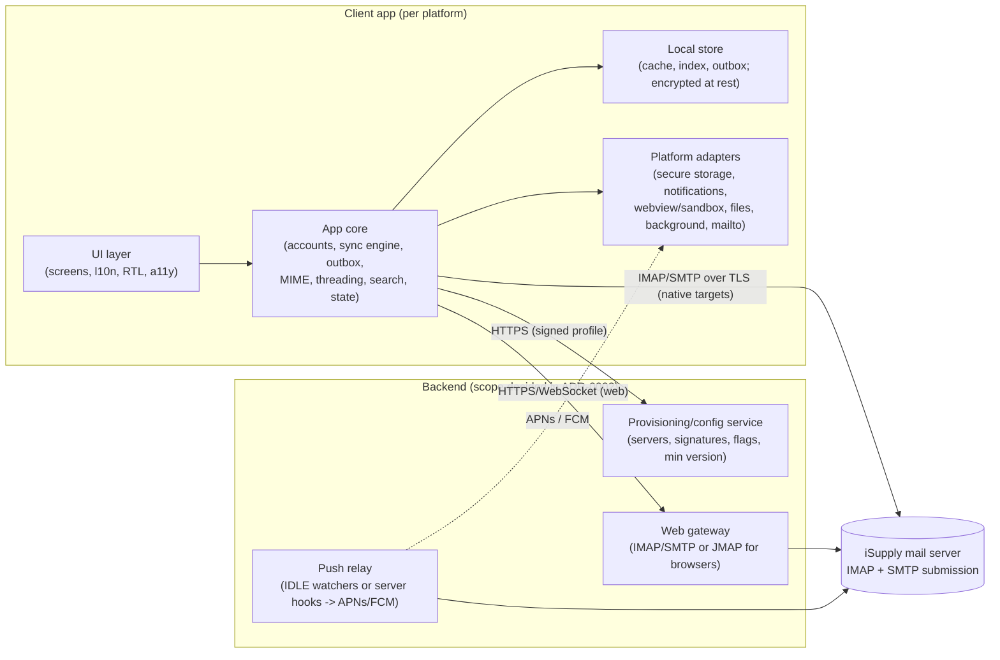

# Architecture overview (stack-independent)

Status: **logical architecture only**. Concrete technologies arrive with
[ADR-0002](../decisions/0002-technology-stack.md), after which `/bootstrap-stack` fills in the
"Physical layout" section.

## Constraints that shape everything

1. **Six targets, one product**: web, Windows, macOS, Linux, Android, iOS.
2. **No sockets in browsers**: the web client needs a server-side **gateway** to reach IMAP/SMTP (or a
   JMAP server).
3. **No background sockets on mobile**: new-mail push needs a server component (**push relay**) that
   watches mailboxes or receives server events and sends APNs/FCM pushes.
4. **We control the domain**: zero-config comes from a central **provisioning** profile, not guessing.
5. **Email is hostile input**: sanitization and sandboxed rendering sit on the critical path.

## Logical components

| Component | Responsibilities | Key rules |
|---|---|---|
| **UI layer** | Screens, navigation, l10n (ar/en), RTL, accessibility, theming | No protocol or business logic; talks to the core through state/view models |
| **App core** | Accounts, provisioning client, sync engine, outbox, MIME parse/compose, threading, search, sanitizer integration | Platform-neutral; the most heavily tested; passes the fixture conformance suite |
| **Local store** | Message metadata cache, bodies on demand, search index, outbox, drafts | Keyed by (account, mailbox, UIDVALIDITY, UID); migrations versioned; encrypted where the platform allows |
| **Platform adapters** | Secure storage, notifications, sandboxed HTML view, file save/share, background scheduling, `mailto:` | One interface, one implementation per platform; contract tests |
| **Provisioning service** | Serves the signed `@isupply.com` profile: hosts, ports, auth method, signature templates, feature flags | Static and versioned; can start as a signed JSON file on HTTPS |
| **Web gateway** | Lets browsers use mail: holds IMAP/SMTP sessions server-side, or exposes JMAP | Crown jewels: credentials encrypted, strict session auth, rate limits, no content logging |
| **Push relay** | Watches the Inbox per device subscription and sends a content-free push ("new mail") | Holds tokens or credentials, so least privilege; payloads carry no message content |

## Key flows

- **Sign-in**: email → provisioning profile (fallback: discovery) → TLS connect → authenticate →
  credentials to secure storage → initial windowed sync → register push.
- **Sync**: IDLE on the Inbox (foreground) plus push wake-ups (background) → incremental sync
  (QRESYNC, or the UID-diff fallback) → store → UI updates.
- **Read**: metadata from the cache → body fetch with BODY.PEEK → MIME parse → sanitize → sandboxed
  render → remote content gated.
- **Send**: compose → outbox (durable) → SMTP submission → APPEND to Sent → flags on the source.

## Open architecture decisions (become ADRs)

1. Sync placement: on-device everywhere plus a gateway for web, vs server-side sync (JMAP-style) for all.
2. Push strategy: relay with IDLE watchers vs server plugin vs polling fallback.
3. Local storage and search engine; encryption at rest per platform.
4. Sanitizer library and rendering surface per platform.
5. Provisioning delivery and signing; admin features (revoke, wipe).

## Physical layout

_Filled in by `/bootstrap-stack` (apps/, packages/, services/ and how they map to the components above)._
